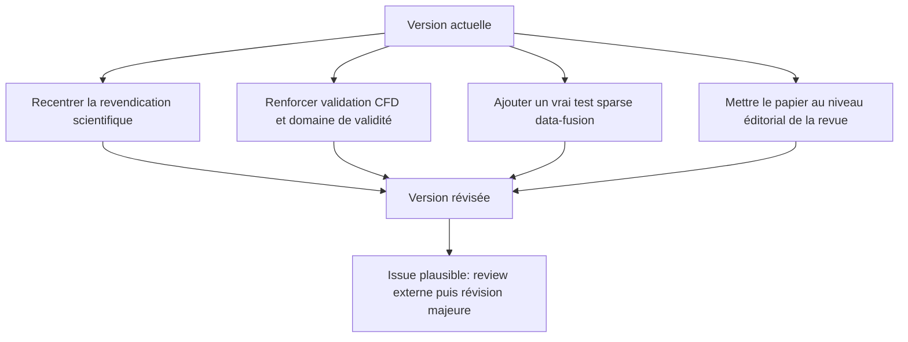

# Évaluation des chances d’acceptation dans Computers & Fluids de votre manuscrit

## Résumé exécutif

Votre manuscrit est **clairement dans le périmètre thématique** de *Computers & Fluids* parce que la revue accepte explicitement les travaux sur les écoulements, les modèles réduits, les modèles substituts, l’optimisation et le contrôle, à condition que la composante computationnelle soit substantielle. Votre texte adopte déjà une structure de type article de recherche avec titre, résumé, mots-clés, sections numérotées, discussion, conclusions, financement, conflits d’intérêts, contributions d’auteurs et disponibilité des données. Il n’est donc **pas hors-format**, et il n’a pas l’apparence d’un manuscrit “non scientifique” ou “hors scope”. citeturn1search0turn3view4turn0file0

En revanche, **dans son état actuel**, le manuscrit me paraît **borderline pour l’acceptation**. Le point fort est un positionnement clair: montrer que la proximité de paroi est un paramètre dominant de fragilité pour les reconstructions POD en contexte de fusion de données peu instrumentée. Les points faibles sont plus lourds: le papier ne propose pas de nouvelle méthode, il n’exécute pas réellement une étape de fusion de données sparse malgré ce cadrage, il reste très court par rapport à de nombreux articles acceptés du corpus récent, il contient encore des `TODO`, il n’offre pas de dépôt reproductible, et surtout il s’appuie sur des simulations **2D de sillage de cylindre jusqu’à Re = 10³–10⁴**, alors que la littérature de référence sur le cylindre indique que la transition vers la tridimensionnalité survient vers **Re ≈ 190**, et que les cas à Re élevés sont généralement étudiés en LES/DNS 3D. Si ce point n’est pas mieux cadré, il risque de déclencher une objection de fond chez les reviewers. citeturn15search6turn15search22turn14search1turn0file0

Mon jugement éditorial synthétique est le suivant: **bonne adéquation à la revue, clarté correcte, mais rigueur scientifique encore insuffisamment sécurisée pour une soumission compétitive**. En l’état, je verrais plutôt une issue du type **rejet après review ou demande de révision majeure très lourde**, plutôt qu’une trajectoire fluide vers acceptation. Si vous implémentez les recommandations prioritaires ci-dessous, le papier peut devenir défendable comme **article diagnostic / benchmark de validité** plutôt que comme article de “nouvelle méthode”. citeturn1search0turn10search3turn20search0turn27search0turn26search0turn0file0

| Axe | Note actuelle | Lecture |
|---|---:|---|
| Acceptabilité globale | **4,8/10** | Soumission **borderline**; probabilité d’acceptation finale en l’état estimée à **faible à modérée** |
| Nouveauté | **5,7/10** | Angle intéressant, mais contribution surtout **diagnostique**, pas méthodologique |
| Rigueur scientifique | **4,6/10** | Bon balayage paramétrique, mais validation et domaine de validité physique insuffisamment verrouillés |
| Clarté | **7,1/10** | Texte lisible et bien structuré, malgré des imprécisions éditoriales notables |
| Adéquation au scope | **8,4/10** | Très bon fit thématique avec *Computers & Fluids* |

Ces notes sont des **inférences expertes** fondées sur le manuscrit transmis, le guide officiel de la revue et un corpus représentatif d’articles récemment acceptés/publiés. citeturn1search0turn0file0turn27search0turn26search0turn10search3turn28search0turn29search0turn29search1

## Référentiel de la revue et des articles acceptés

Le guide officiel impose notamment un **résumé ≤ 250 mots**, **1 à 7 mots-clés en anglais**, des **highlights obligatoires** à la soumission sous forme de **fichier séparé** avec **3 à 5 puces** de **85 caractères maximum chacune**, des sections clairement **numérotées**, un **source file éditable** en `.doc/.docx` ou `.tex`, des **figures séparées**, une **data statement obligatoire** à la soumission, et l’application de l’option Elsevier “Research Data Option C” qui demande soit le dépôt/citation des données, soit une explication explicite de l’impossibilité de partage. Le guide demande aussi une déclaration de conflits d’intérêts via l’outil Elsevier, une déclaration d’usage de l’IA si pertinent, et un énoncé de contributions en **CRediT**. citeturn2view0turn2view1turn2view2turn2view3turn2view4turn2view5turn3view0turn3view1turn3view2turn3view4turn3view5turn4view0turn4view1turn4view2

À partir des articles récents les plus proches de votre thème, on observe aussi un **profil éditorial récurrent**: les papiers acceptés proposent presque toujours soit **une méthode nouvelle**, soit **une comparaison méthodique avec baselines**, presque toujours avec **plusieurs cas de validation**, un exposé explicite des **performances**, et souvent une section **Data availability** plus robuste que “sur demande”. Votre manuscrit s’aligne sur le squelette formel, mais il est plus **court**, plus **narratif**, et surtout moins **benchmarké** que la médiane de cet échantillon. citeturn27search0turn26search0turn10search3turn20search0turn28search0turn29search0turn29search1turn0file0

| Manuscrit / article | Titre / thème | Méthodes | Validation | Revendication de nouveauté | Résultat principal | Structure / longueur | Figures / tableaux | Adhérence au style de la revue |
|---|---|---|---|---|---|---|---|---|
| **Votre manuscrit** fileciteturn0file0 | *Gauging Unsteady Reconstruction Accuracy in wall-confined wakes: robustness limits of POD-based reduced-order models for sparse-flow data fusion*; diagnostic de robustesse du POD en sillage confiné | POD sur champs de pression CFD 2D; seuil de 99 % d’énergie; RMSE temporelle; ablations par fenêtre spatiale, raffinement et translation | CFD synthétique interne; pas d’expérience, pas d’assimilation sparse réellement exécutée | Pas de nouvelle méthode; carte diagnostique des limites d’un front-end POD pour data fusion sparse | La proximité de paroi domine l’erreur de reconstruction davantage que Re dans la plage étudiée; l’énergie retenue ne suffit pas comme indicateur de robustesse | 6 sections principales; résumé de 224 mots; 7 mots-clés; texte relativement court pour un article complet | **7 / 0** | **Partielle**: squelette correct, mais `TODO`, pas de tableaux, highlights trop longs, déclaration IA mal placée, CRediT non conforme citeturn0file0 |
| **Gkimisis et al. 2024** citeturn27search0turn27academia10turn13view0turn13view2 | *Adjacency-based, non-intrusive model reduction for vortex-induced vibrations*; ROM non intrusif VIV | Inférence opératorielle sparse, structure adjacency-based, projection POD, couplage fluide-structure | CFD 2D VIV à Re = 90 et 180 | Méthode non intrusive physiquement structurée pour VIV | Erreurs < 3 % sur champ fluide et oscillation solide | Article standard de recherche, méthode + validation + étude de dimension | **15 / 1** | **Très bonne**: highlights, abstract, keywords, data availability, structure très normalisée |
| **Van Gastelen et al. 2026** citeturn26search0turn26search1turn26search2turn17search0 | *Modeling advection-dominated flows with space-local reduced-order models*; POD local pour écoulements advectifs | Space-local POD, sous-domaines chevauchants, propriété de stabilité | Cas 1D et 2D d’advection; généralisation hors entraînement | POD local pour contourner la lente décroissance spectrale des problèmes advectifs | Meilleure généralisation, conservation/stabilité héritées, pas de temps plus grands | **16 pages** dans la version publiée; structure compacte et strictement benchmarkée | **13 / 1** | **Très bonne**; code GitHub explicitement fourni dans *Data availability* |
| **Valero & Meldi 2025** citeturn10search3turn14search6turn23search1 | *Improved State Estimation for turbulent flows combining Ensemble Data Assimilation and Machine Learning*; estimation d’état turbulente sparse | EnKF + ML correctif; IBM coarse-grained | Canal turbulent; observations issues d’un calcul affiné; étude d’estimation | Couplage DA/ML pour améliorer la reconstruction lorsqu’il manque des capteurs | Gain d’exactitude à coût réduit dans un cas turbulent de référence | Article de validation applicative avec cas turbulent et métriques | **≈12 / 2** | **Très bonne**; highlights, abstract, data availability, structure de validation forte |
| **Lepage et al. 2025** citeturn10search0turn29search1turn31search1turn31search4 | *Hybrid AutoEncoder/Galerkin approach for nonlinear reduced order modelling*; ROM hybride POD + DL | POD/Galerkin + autoencodeur pour corriger erreur de projection et d’intégration | Cas non linéaires de ROM; comparaison à ROM hybrides antérieurs | Correction simultanée intra- et extra-sous-espace POD | Meilleure précision prédictive qu’un Galerkin classique | Article de méthode, orienté validation comparative | **≈11 / 2** | **Très bonne**; titre méthodologique, validation comparative, codage éditorial standard |
| **Eiximeno et al. 2025** citeturn29search0turn34search0turn30search1turn30search3 | *On the integration of geometry agnostic variational-autoencoders into large-scale SVD based models*; réduction grande échelle sur grille non structurée | QR parallèle + VAE geometry-agnostic; compression HPC | Cas de cylindre à **Re = 10⁴** sur grille non structurée de 72 M points | Réduction d’ordre scalable sur états de taille téraoctet | Compression de **1,1 To** en **3 variables latentes** avec jusqu’à **91,28 %** d’énergie retrouvée | Article long de méthode/scalabilité; spécial issue *Fusing Data and Physics* | **≈11 / 2** | **Très bonne**; forte revendication méthodologique, résultat quantifié, spécial issue |
| **Schwarz et al. 2025** citeturn28search0turn28search2turn13view1turn13view3 | *Disentangled latent spaces for reduced order models using deterministic autoencoders*; ROM autoencodeur interprétable | AEs déterministes, pénalité de corrélation, comparaison au β-VAE | Dataset périodique + application industrielle de ditching | Désenchevêtrer l’espace latent de manière plus robuste que β-VAE | Plus de robustesse vis-à-vis des hyperparamètres; bonne “physics-awareness” | Article richement illustré, double cas d’étude | **25 / 2** | **Très bonne**; donne dataset source dans *Data availability* |

**Lecture comparative.** Les articles acceptés de l’échantillon proposent presque tous soit une **méthode nouvelle**, soit une **comparaison systématique de méthodes** sur plusieurs cas, avec un niveau de validation supérieur à celui de votre manuscrit. Le vôtre est plus proche d’un **paper de diagnostic de domaine de validité**; cela peut marcher dans *Computers & Fluids*, mais à condition que le papier soit plus dur scientifiquement qu’il ne l’est aujourd’hui. citeturn27search0turn26search0turn10search3turn28search0turn29search0turn29search1turn0file0

## Diagnostic du manuscrit

Sur la **forme**, votre manuscrit est déjà mieux avancé que beaucoup de brouillons: la ligne argumentative est lisible, l’introduction expose une question claire, les méthodes sont séparées des résultats, et la discussion comporte explicitement une section “Limitations”, ce qui est un bon signal pour des reviewers de *Computers & Fluids*. L’abstract fait **224 mots**, donc il respecte la borne de **250 mots**; vous avez **7 mots-clés**, soit exactement le maximum autorisé; les sections sont numérotées conformément au guide. En revanche, les **5 highlights** dépassent tous la limite de **85 caractères** fixée par la revue, avec des longueurs d’environ **102 à 117 caractères**; le titre est très long (**144 caractères**) et plus discursif que la moyenne des articles acceptés de l’échantillon; et le manuscrit contient encore des `TODO`, ce qui est rédhibitoire au moment de la soumission. citeturn2view0turn2view1turn3view4turn0file0

Sur la **qualité scientifique**, il y a un vrai noyau publiable. Le papier ne se contente pas d’une simple observation qualitative: il varie le nombre de Reynolds, la distance à la paroi, la taille de fenêtre spatiale, la résolution et la translation du corps; il montre que la dépendance à la paroi est non linéaire; et il explicite que le critère “99 % d’énergie POD” n’est pas un proxy de robustesse suffisant lorsqu’on traverse des régimes de sillage différents. Ces éléments donnent au papier une vraie colonne vertébrale méthodique. citeturn0file0

Le problème est que cette méthodologie reste **insuffisamment verrouillée** au regard des standards des papiers acceptés les plus proches. Vos comparateurs récents dans *Computers & Fluids* vont typiquement jusqu’à une vraie démonstration d’estimation d’état sparse, une étude de placement de capteurs et de bruit, une comparaison avant/après correction, ou une démonstration de généralisation hors ensemble d’apprentissage. Votre papier, lui, s’arrête avant l’étape clé: il **parle** de fusion de données sparse, mais il **n’exécute pas** une expérience de reconstruction à partir de capteurs dispersés ou de pressions murales. Un reviewer pourra donc dire, à juste titre, que le papier traite surtout de **robustesse du POD**, pas encore de **data fusion**. citeturn10search3turn20search0turn20search5turn0file0

Le **risque scientifique majeur** est le domaine de validité physique de votre base de données. Vous utilisez un cylindre 2D dans une cuve, et vous concluez à partir d’une plage **Re = 10³–10⁴**. Or les références de la transition de sillage de cylindre montrent que le passage à la tridimensionnalité intervient vers **Re ≈ 190**, et les cas à **Re = 3900** ou supérieurs sont classiquement étudiés en LES/DNS 3D plutôt qu’en 2D. Vous le reconnaissez partiellement dans vos limitations, mais pas avec assez de force dans le résumé, le titre et les conclusions. En l’état, le texte peut être lu comme une conclusion générale sur les sillages confinés, alors qu’il s’agit plutôt d’un **benchmark synthétique 2D** utile pour tester la robustesse représentationnelle d’un pipeline POD. C’est défendable, mais il faut le dire plus explicitement et réduire toute sur-interprétation physique. citeturn15search6turn15search22turn14search1turn0file0

La **nouveauté** est donc réelle mais d’un type particulier. Elle n’est pas dans une nouvelle technique de ROM, comme chez Gkimisis, Van Gastelen, Lepage, Eiximeno ou Schwarz; elle est dans le fait de poser **la distance à la paroi comme paramètre dominant d’incertitude représentationnelle** pour un front-end POD destiné à des usages de reconstruction sparse. C’est une contribution intéressante, surtout si vous la vendez comme **résultat négatif structuré / benchmark de robustesse**, mais elle sera jugée plus sévèrement qu’un papier de nouvelle méthode. Pour être convaincante, cette nouveauté doit être accompagnée soit d’un **benchmark plus fort**, soit d’une **comparaison à au moins une alternative** comme local POD, SPOD, gappy POD, base adaptative, simple observateur ou assimilation minimale. citeturn27search0turn26search0turn29search1turn28search0turn0file0

Enfin, la **reproductibilité** est trop faible pour 2026. Le guide demande une *data statement* et applique l’option Elsevier “Research Data Option C”; plusieurs articles récents de votre corpus vont plus loin, en donnant un dépôt GitHub, un dataset public ou au moins une disponibilité explicite et exploitable. Votre manuscrit se limite à “Raw data are available from the corresponding author” et contient un `TODO` vous rappelant vous-même de déposer données et scripts. Ce point est objectivement en dessous du niveau attendu pour un papier computationnel qui prétend cartographier la robustesse d’un pipeline. citeturn3view0turn3view1turn17search0turn28search0turn0file0

## Conformité éditoriale et dossier de soumission

| Élément | Exigence officielle *Computers & Fluids* | État dans le manuscrit transmis | Diagnostic |
|---|---|---|---|
| Fichier source éditable | `.doc/.docx` ou `.tex`; PDF non accepté comme source; Word en une colonne | DOCX fourni | **Conforme** citeturn3view2turn0file0 |
| Titre | Concis et informatif; éviter abréviations/formules si possible | Titre clair mais très long et assez “discursif” | **Partiel** citeturn2view2turn0file0 |
| Page de titre | Noms auteurs; affiliations; coordonnées correspondance à jour | Présent; mais affiliations peu détaillées et numérotation non conforme à l’exemple officiel | **Partiel** citeturn2view2turn4view1turn0file0 |
| Résumé | Obligatoire; ≤ 250 mots | 224 mots | **Conforme** citeturn2view0turn0file0 |
| Mots-clés | 1 à 7, en anglais | 7 mots-clés en anglais | **Conforme** citeturn2view3turn0file0 |
| Highlights | Obligatoires à la soumission; fichier séparé; 3 à 5 puces; 85 caractères max/puce | 5 puces, mais chacune dépasse la limite; fichier séparé non montré | **Non conforme / partiel** citeturn2view1turn0file0 |
| Structure de l’article | Sections numérotées claires | Oui | **Conforme** citeturn3view4turn0file0 |
| Figures | Fichiers séparés; toutes citées; numérotées dans l’ordre | Figures présentes et citées; fichiers séparés non vérifiables à partir du seul DOCX | **Partiel** citeturn2view4turn0file0 |
| Tableaux | Texte éditable, légendes, citations | Aucun tableau | **Acceptable mais stratégiquement faible** citeturn2view1turn0file0 |
| Data statement | Obligatoire à la soumission | Présente | **Conforme minimalement** citeturn3view0turn0file0 |
| Politique données | Déposer et citer les données **ou** expliquer pourquoi ce n’est pas possible | “Available from corresponding author”; pas de DOI; `TODO` de dépôt | **Partiel** citeturn3view1turn0file0 |
| Conflits d’intérêts | Déclaration obligatoire via l’outil Elsevier; fichier Word à téléverser | Déclaration dans le manuscrit; fichier généré par l’outil non montré | **Partiel** citeturn4view2turn0file0 |
| Financement | Déclaration requise | Présente | **Conforme** citeturn4view2turn0file0 |
| Contributions auteurs | Utilisation des rôles **CRediT** demandée | Contributions rédigées en prose libre, pas en taxonomie CRediT | **Non conforme / partiel** citeturn3view5turn0file0 |
| Déclaration IA | Si usage d’IA: section dédiée avant les références avec formulation type | Déclaration présente mais placée sous “Acknowledgements”; intitulé non conforme | **Non conforme** citeturn4view0turn4view1turn0file0 |
| Supplémentaires / vidéos | Si cités, doivent être fournis au dépôt initial | Deux vidéos/animations mentionnées comme `TODO` mais non fournies | **Non conforme en l’état** citeturn2view4turn9view1turn0file0 |
| Références | Style libre à la soumission, mais cohérent et complet; DOI recommandés | Cohérent globalement; plusieurs références pourraient être renforcées / actualisées | **Partiel** citeturn3view3turn0file0 |

Le point important n’est pas seulement la conformité “administrative”. Plusieurs de ces écarts, notamment les `TODO`, la déclaration IA, l’absence de CRediT et l’insuffisance de la *data statement*, sont aussi des **signaux de manuscrit non finalisé**. Pour un éditeur, cela augmente le risque de rejet rapide même si le sujet est pertinent. citeturn4view1turn3view5turn0file0

## Recommandations prioritaires

Le plus efficace n’est pas une réécriture cosmétique, mais une **reconstruction ciblée** du papier autour d’une promesse plus crédible: **“benchmark diagnostique de robustesse d’un front-end POD en sillage confiné”**. C’est sur ce terrain que votre contribution peut devenir originale et honnête à la fois. citeturn0file0turn27search0turn26search0

| Priorité | Recommandation | Pourquoi c’est prioritaire | Effet attendu sur l’acceptation |
|---|---|---|---|
| **Critique** | **Re-cadrer explicitement l’étude comme benchmark synthétique 2D**, et non comme conclusion générale sur les sillages confinés réels à haut Re | Le point le plus vulnérable aujourd’hui est l’usage de cas 2D jusqu’à Re = 10³–10⁴ alors que le cylindre devient 3D vers Re ≈ 190 | Réduit le risque de rejet pour “surclaim” physique citeturn15search6turn15search22turn14search1turn0file0 |
| **Critique** | **Ajouter au moins une vraie expérience de data fusion sparse**: reconstruction à partir de capteurs muraux synthétiques ou observations sous-échantillonnées | Sinon le papier reste un article sur la reconstruction POD seule, alors que le framing annonce davantage | Rend la promesse scientifique cohérente avec le titre et l’abstract citeturn10search3turn20search0turn0file0 |
| **Critique** | **Introduire au moins un baseline comparatif**: local POD, SPOD, gappy POD, base adaptative, ou observateur simple | Les papiers récents acceptés proposent presque tous une comparaison plus serrée qu’un simple POD global | Augmente nettement la valeur démonstrative du papier citeturn26search0turn27search0turn29search1turn28search0 |
| **Critique** | **Ajouter une validation/verification CFD plus explicite**: maillage, pas de temps, BCs, Strouhal/forces/régimes vs littérature à quelques cas représentatifs | Aujourd’hui, la simulation est surtout décrite comme génératrice de dataset, pas comme modèle vérifié | Sécurise la rigueur aux yeux des reviewers CFD citeturn14search1turn0file0 |
| **Haute** | **Déposer scripts + données + index des cas sur dépôt avec DOI** | Votre propre `TODO` identifie déjà ce manque; le guide et plusieurs papiers récents poussent dans ce sens | Améliore fortement la crédibilité et la réutilisabilité citeturn3view1turn17search0turn28search0turn0file0 |
| **Haute** | **Transformer les résultats en tableaux synthétiques**: matrice des cas, métriques RMSE, sensibilité au seuil d’énergie, effet de fenêtre/résolution/translation | L’absence totale de tableaux est inhabituelle dans votre échantillon comparatif et nuit à la lisibilité quantitative | Facilite le travail des reviewers et la solidité du message citeturn13view2turn23search1turn31search1turn30search1turn13view3turn0file0 |
| **Haute** | **Réviser le titre et le cadrage des claims** | Le titre actuel est long et promet une portée “data fusion” que le protocole ne matérialise pas entièrement | Réduit l’effet de déception reviewer/editor citeturn2view2turn0file0 |
| **Moyenne** | **Raccourcir les highlights** à ≤ 85 caractères et les fournir dans un fichier séparé | Exigence explicite de la revue | Évite un irritant éditorial immédiat citeturn2view1turn0file0 |
| **Moyenne** | **Mettre la déclaration IA dans une section dédiée avant les références** et réécrire les contributions en **CRediT** | Deux écarts formels nets au guide | Supprime deux non-conformités visibles citeturn4view1turn3view5turn0file0 |
| **Moyenne** | **Supprimer tous les `TODO` et fournir les suppléments promis** | Aucun manuscrit compétitif n’est soumis avec des marqueurs internes non résolus | Évite le signal de brouillon non finalisé citeturn9view1turn0file0 |

Sur le plan rédactionnel, je vous conseillerais aussi une reformulation de la proposition de valeur en une phrase du type: *“We provide a diagnostic benchmark showing when a fixed, energy-truncated POD basis ceases to be robust for sparse reconstruction in wall-confined wakes.”* C’est plus précis, plus crédible, et plus aligné avec ce que le papier démontre réellement. Cette reformulation réduirait aussi la pression reviewer d’attendre un vrai algorithme de fusion. citeturn0file0

## Relecteurs ou équipes potentielles

Je recommande de penser en termes **d’équipes / groupes**, pas seulement d’individus, et de filtrer ensuite selon les conflits d’intérêts, co-publications récentes, proximité institutionnelle ou participation à des projets communs. La logique ici est de viser des reviewers qui comprennent à la fois les **ROM POD**, la **reconstruction/généralisation**, et si possible la **data assimilation sparse**. citeturn27search0turn26search0turn10search3turn20search0turn29search1turn28search0

| Équipe / groupe | Pourquoi c’est pertinent | Point d’attention |
|---|---|---|
| **CWI Amsterdam / TU Eindhoven – groupe B. Sanderse, W. Edeling, T. van Gastelen** citeturn26search0turn26search2turn26search11turn26search12 | Compétence forte en POD local, stabilité et généralisabilité des ROM pour écoulements advectifs | Très pertinent pour juger vos conclusions sur la fragilité du POD global |
| **MPI Magdeburg / OVGU – groupe P. Benner, T. Richter, L. Gkimisis** citeturn27search0turn27search9 | ROM non intrusifs, VIV, couplage physique et robustesse paramétrique | Très bon fit pour la partie “ROM + sillage” |
| **Arts et Métiers / dynamique des fluides – groupe M. Meldi** citeturn10search3turn14search6 | Assimilation de données, estimation d’état sparse, turbulence et hybridation DA/ML | Excellent pour tester la crédibilité de votre framing “data fusion” |
| **Sun Yat-sen University / thermique et ROM – groupe J. Song, D. Yang, C. Dai, C. Zhang** citeturn20search0turn20search11 | POD-Galerkin + 3DVar, bruit, placement de capteurs, estimation paramètre-état | Très bonne proximité thématique avec l’idée de reconstruction sparse |
| **ONERA / ENS / dynamiques réduites – groupe S. Beneddine, D. Sipp, C. Fiorini, N. Thome** citeturn29search1turn31search4turn31search6 | Hybridation POD/deep learning, dynamique réduite, écoulements non linéaires | Très bon regard sur ce qu’un article “diagnostic vs méthode” doit démontrer |
| **TU Hamburg – groupe T. Rung / H. Schwarz** citeturn28search0turn28search2 | Interprétabilité des ROM autoencodeurs, physique des variables latentes, applications industrielles | Pertinent si vous ajoutez une comparaison à approches adaptatives / non linéaires |
| **Barcelona Supercomputing Center / UPC / CTTC – groupe O. Lehmkuhl, A. Miró, I. Rodriguez, B. Eiximeno** citeturn29search0turn29search8turn30search3 | ROM à grande échelle, géométries complexes, cas de cylindre à Re élevé, crédibilité CFD/HPC | Très utile pour juger la robustesse numérique et la portée du dataset |
| **Équipe liée à Saredi / Sciacchitano / Scarano** citeturn0file0turn112search? | L’article C&F 2021 sur assimilation d’état avec PIV et RANS est conceptuellement proche de votre promesse | À utiliser surtout si vous renforcez l’aspect assimilation réelle |

Pour la dernière ligne, je n’ai pas réouvert de source institutionnelle spécifique dans cette session; je la propose parce que vous citez vous-même cet axe de travail, et parce qu’il est très proche conceptuellement de votre promesse scientifique. fileciteturn0file0

## Sources primaires, écarts saillants et questions ouvertes

### Sources primaires utilisées

| Source | Type | DOI / identifiant | Usage |
|---|---|---|---|
| *Computers & Fluids* – Guide for Authors | Source officielle revue | n.a. | Scope, format, soumission, données, CRediT, IA, checklist citeturn1search0turn2view0turn2view1turn2view2turn2view3turn2view4turn2view5turn3view0turn3view1turn3view2turn3view4turn3view5turn4view0turn4view1turn4view2 |
| Votre manuscrit transmis | Source primaire utilisateur | fichier DOCX transmis | Contenu, structure, messages, limites, conformité interne fileciteturn0file0 |
| Gkimisis et al. 2024 | Article *Computers & Fluids* | **10.1016/j.compfluid.2024.106248** | Référentiel ROM/VIV non intrusif citeturn27search0turn27search9turn13view0turn13view2 |
| Van Gastelen et al. 2026 | Article *Computers & Fluids* | **10.1016/j.compfluid.2025.106911** | Référentiel POD local / robustesse / code dispo citeturn26search0turn26search2turn17search0 |
| Valero & Meldi 2025 | Article *Computers & Fluids* | **10.1016/j.compfluid.2025.106757** | Référentiel estimation d’état sparse via DA/ML citeturn10search3turn14search6turn23search1 |
| Dai et al. 2025 | Article *Computers & Fluids* | **10.1016/j.compfluid.2025.106815** | Référentiel POD-Galerkin + 3DVar, capteurs et bruit citeturn20search0turn20search5turn20search11 |
| Lepage et al. 2025 | Article *Computers & Fluids* | **10.1016/j.compfluid.2025.106811** | Référentiel ROM hybride POD/DL citeturn29search1turn29search13 |
| Eiximeno et al. 2025 | Article *Computers & Fluids* | **10.1016/j.compfluid.2025.106797** | Référentiel ROM/VAE grande échelle, cas cylindre Re élevé citeturn29search0turn29search8turn30search1 |
| Schwarz et al. 2025 | Article *Computers & Fluids* | **10.1016/j.compfluid.2025.106837** | Référentiel ROM autoencodeur interprétable citeturn28search0turn28search2turn13view1turn13view3 |
| Williamson 1996 et synthèses associées sur la transition du cylindre | Références de physique du sillage | n.a. | Étayer la critique sur la tridimensionnalité vers Re ≈ 190 citeturn15search6turn15search22 |
| Étude LES cylindre à Re = 3900 | Référence de benchmark haute-Re | n.a. | Étayer le contraste entre vos cas 2D et la pratique haute-Re | citeturn14search1 |

### Écarts saillants entre votre manuscrit et les papiers typiquement acceptés

| Écart | Votre manuscrit | Échantillon d’articles acceptés |
|---|---|---|
| Type de contribution | Diagnostic de limites du POD, sans nouvelle méthode | Souvent nouvelle méthode, ou au minimum comparaison méthodique de plusieurs variantes citeturn27search0turn26search0turn29search1turn28search0turn0file0 |
| Validation | Reconstruction POD interne sur dataset synthétique | Validation multi-cas, souvent avec tests de généralisation, bruit, capteurs, erreurs, coût ou stabilité citeturn10search3turn20search0turn26search0turn27search0turn0file0 |
| Lien avec la promesse “fusion de données” | Promesse forte, démonstration indirecte | Les papiers voisins vont jusqu’au test d’assimilation / estimation effectif citeturn10search3turn20search0turn0file0 |
| Rigueur CFD | Domaine de validité physique discutable à haut Re en 2D | Les papiers haute-Re récents mobilisent des stratégies numériques plus réalistes pour ces régimes citeturn14search1turn15search22turn0file0 |
| Reproductibilité | Données “sur demande”, pas de dépôt, `TODO` restant | De “sur demande” à code/dataset explicites; rarement un brouillon avec items non résolus citeturn3view1turn17search0turn28search0turn0file0 |
| Présentation quantitative | 7 figures, 0 tableau | Les papiers comparés utilisent en général au moins 1–2 tableaux de benchmarks/paramètres/hyperparamètres citeturn13view2turn23search1turn31search1turn30search1turn13view3turn0file0 |

### Questions ouvertes et limites de cette évaluation

Cette évaluation est **robuste sur le fond**, mais elle comporte trois limites qu’il vaut mieux expliciter. D’abord, je n’ai pas eu accès à tous les **PDF finaux éditeur** des articles comparés; pour quelques papiers, le comptage figures/tableaux repose sur des versions ouvertes, dépôts institutionnels, arXiv ou snippets indexés, de sorte que certains décomptes doivent être lus comme **approximatifs**. Ensuite, ma note d’acceptabilité est un **jugement d’expert**, pas une statistique officielle du journal. Enfin, si vous disposez déjà, hors du fichier transmis, d’un **dépôt de données**, d’un **fichier highlights séparé**, d’un **document Elsevier declarations tool** et d’un **plan de validation sparse-sensor**, votre position réelle est un peu meilleure que celle évaluée ici, car ces éléments n’étaient pas visibles dans le manuscrit fourni. citeturn26search2turn28search2turn0file0